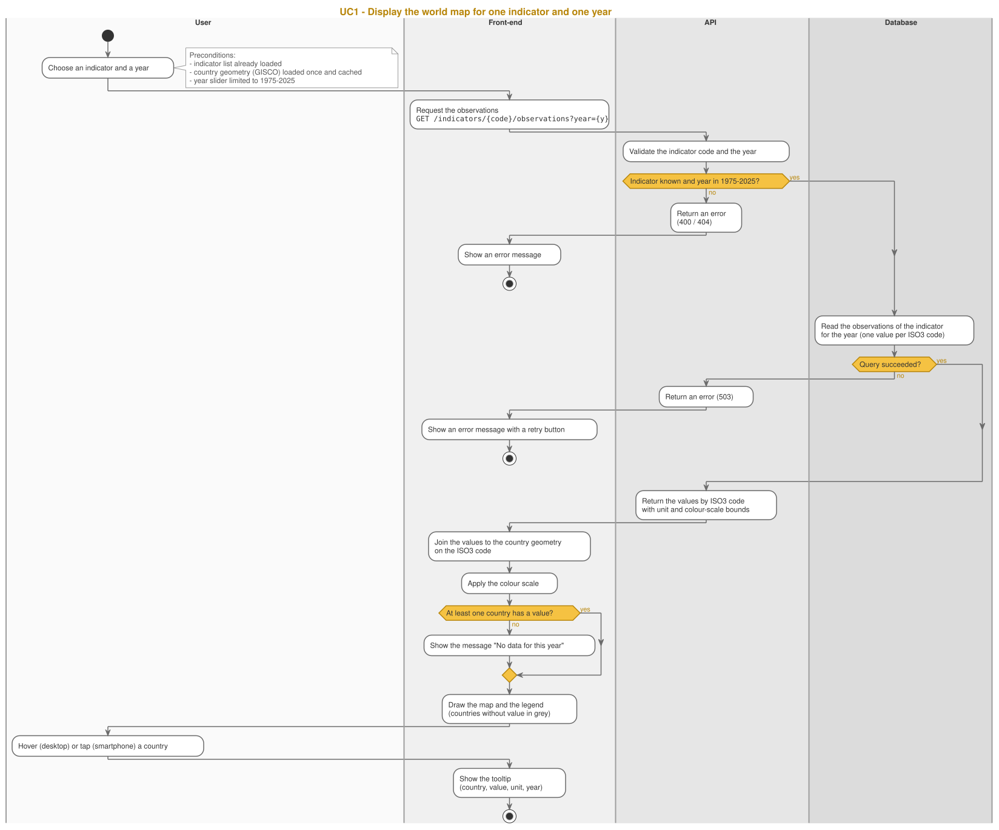
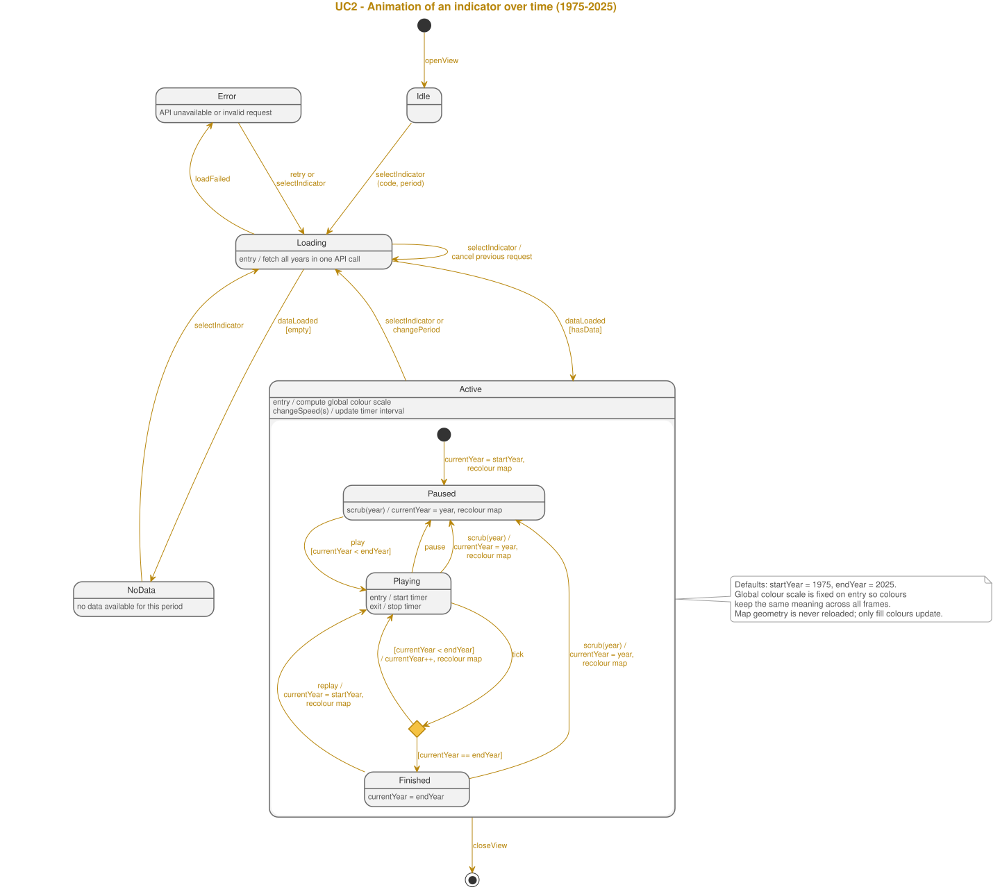

# Development Globe

*Software Engineering project 2026-2027 (NTUA) — Project overview and work plan for Submission 1 (30 November 2026)*

---

## 1. What the course asks us to do

We pick 1 to 3 open data sources and build a software application around them. The same application must be built **twice**, with two different architectures, and fully documented (requirements, UML, API docs, tests).

- **Layered architecture:** backend, REST API, a Command Line Interface (CLI) that calls the API, and a responsive web frontend (desktop + smartphone).
- **MVC architecture:** backend (Model + Controller), REST API, and two separate web Views: one for desktop, one for smartphone.
- **Mandatory tools:** GitHub (each member with their own account), PlantUML + Markdown for diagrams and the SRS (no Word, no images), Visual Paradigm for the full UML model, GitHub Projects for project management.
- **As a team of 6** we need: an SRS with **7 use cases**, and **4 use cases** implemented in the frontend.

### Deadlines

| Date | What is due |
|---|---|
| **30 Nov 2026** | Complete SRS document, conceptual data diagram, UML activity and state diagrams — on GitHub. |
| **10 Jan 2027** | Everything else: class, API, component and deployment diagrams, Visual Paradigm models, backend, data dump, REST API + docs, CLI, frontends, tests. |

Individual grades can differ according to each member's recorded contribution on GitHub, so everyone must commit their own work.

---

## 2. Our application: Development Globe

An interactive world map showing how countries have evolved over the last 50 years. The user picks an indicator (life expectancy, GDP per capita, access to electricity, CO₂ emissions...) and scrolls through the years to watch the world change. Users can also build their own **custom index** by weighting several indicators, then compare and rank countries.

### Data sources

- **World Bank Indicators API** — about 16,000 indicator time series per country, many over 50 years. No key needed. JSON.
- **GISCO Countries (Eurostat)** — worldwide country boundaries (GeoJSON). No key needed.
- The two are joined on the **ISO3 country code** (not the 2-letter code: Eurostat uses `EL` for Greece, not `GR`).

### Known data pitfalls (to mention in the SRS)

- The World Bank API also returns **aggregates** (World, Euro area, income groups...) that must be filtered out of the map.
- **Missing values** are common (small countries, old years): we must decide how to show them (grey, "no data").
- Data is **yearly**: there is no real-time data, which is fine for this subject.

### Use cases (7)

| # | Use case | Frontend? |
|---|---|---|
| UC1 | Display the world map for one indicator and one year | Yes |
| UC2 | Animate the evolution of an indicator over a period of years | Yes |
| UC3 | View a country profile with the time series of its indicators | Yes |
| UC4 | Compare several countries on one or more indicators | Yes |
| UC5 | Create a custom index (weighted indicators) and get the country ranking | No (API) |
| UC6 | Export data as CSV or JSON through the API (also the basis of the CLI) | No (API/CLI) |
| UC7 | Administer the import and update of World Bank and GISCO data | No (admin) |

---
Diagrams:

*UC1 activity diagram. Source: [softeng26-02-uc01-activity.puml](diagram-as-code/layered/softeng26-02-uc01-activity.puml)*


*UC2 state diagram. Source: [softeng26-02-uc02-state.puml](diagram-as-code/layered/softeng26-02-uc02-state.puml)*


### State diagrams

To have objects with a real lifecycle, we model two of them:

- **Custom index:** Draft → Computed → Published/Shared → Archived.
- **Import job:** Scheduled → Running → Completed or Failed (with retry).

### Conceptual data model (starting point)

- **Country**: ISO3 code, name, region, income group, geometry.
- **Indicator**: code, name, unit, topic.
- **Observation**: country, indicator, year, value.
- **CustomIndex** and **IndexComponent**: the index, then for each indicator in it its weight and normalisation method.
- **ImportJob**: source, status, dates, errors.

---

## 3. Programming languages and tech stack

The course allows Python or JavaScript (Node/Express) for the backend, PostgreSQL or MongoDB for data, and any frontend framework. Our choice:

| Part | Choice | Why |
|---|---|---|
| Backend + REST API | **Python + FastAPI** | Generates the OpenAPI documentation automatically (a graded deliverable); Python is excellent for loading and cleaning World Bank data. |
| Database | **PostgreSQL + PostGIS** | Data is tabular (country / indicator / year / value); PostGIS stores country geometries. SQL dump is easy to deliver. |
| CLI (layered) | **Python + Typer** | Same language as the backend; simple commands calling the REST API. |
| Frontend | **React (Vite) + Leaflet** | Leaflet handles GeoJSON choropleth maps; React makes the desktop and smartphone Views easy to separate for MVC. |
| Tests | **pytest** (API, CLI), **Locust** (performance) | All Python, same tooling for everybody. |

**Note:** no code is due on 30 November; only documentation and diagrams. Before coding starts (January), everyone needs Python 3.11+, PostgreSQL and Node.js (for the React frontend only) installed.

---

## 4. Work split for Submission 1 (30 November)

Principle: each member owns one or two use cases **end to end** (SRS text + activity diagrams in **both** architectures). This makes contributions clearly visible on GitHub.

| Member | Responsibility | Files to deliver |
|---|---|---|
| **Valentin** — Coordinator | CLAUDE.md Conception, SRS general sections (introduction, scope, glossary, non-functional requirements), consistency of the whole SRS, GitHub Project board, final review. | `srs-softeng26-02.md` (general parts) |
| **William** — Data | Explore World Bank API and GISCO join; conceptual data model for both architectures; data section of the SRS. | data-conceptual `.puml` (layered + mvc) |
| **Anthony** | UC1 (map) and UC2 (animation): SRS description + activity diagrams. | 4 activity `.puml` |
| **Jonah** | UC3 (country profile) and UC4 (comparison): SRS description + activity diagrams. | 4 activity `.puml` |
| **Jules** | UC5 (custom index): SRS description + activity diagrams + Custom index state diagram. | 2 activity + 2 state `.puml` |
| **Edrik** | UC6 (export) and UC7 (admin import): SRS description + activity diagrams + Import job state diagram. | 4 activity + 2 state `.puml` |

**File naming** (required by the course): `softeng26-02-[diagram_id].puml`, e.g. `softeng26-02-uc01-activity.puml`, `softeng26-02-state-custom-index.puml`. Each diagram goes in both `documentation/diagram-as-code/layered` and `documentation/diagram-as-code/mvc`, with differences reflecting each architecture.

### Timeline

| Day | Goal |
|---|---|
| **Thu 26 Nov** | Repository and folder structure ready, everyone has access, GitHub Project board with one issue per task. Use cases and work split validated. |
| **Fri 27 Nov** | Drafts: each member writes their use case descriptions; William shares the data model so diagrams use the same entity names. |
| **Sat 28 Nov** | All PlantUML diagrams written and rendering without errors; pull requests opened. |
| **Sun 29 Nov** | Cross-review (each member reviews someone else's work), Valentin integrates the full SRS, fixes. |
| **Mon 30 Nov** | Final check of file names and folders, merge into main, submission. |

---

## 5. GitHub rules for the team

- Nobody pushes directly to **main**: every change goes through a pull request reviewed by another member.
- One branch per task, e.g. `srs/uc3-country-profile` or `diagrams/state-import-job`.
- One GitHub issue per task, assigned to its owner, in the milestone "Submission 1 – 30/11".
- Clear commit messages saying what changed. Commit often: contributions are graded individually.

### Repository structure

```
documentation/requirements/          srs-softeng26-02.md
documentation/diagram-as-code/layered/
documentation/diagram-as-code/mvc/
documentation/visual-paradigm/
documentation/apis/
layered/  backend, cli, frontend, data, testing
mvc/      backend, frontend, data, testing
```

### Checklist before 30 November

- [ ] SRS complete with the 7 use cases, in Markdown with embedded PlantUML.
- [ ] Conceptual data diagram in both architecture folders.
- [ ] Activity diagrams for every use case, in both architectures.
- [ ] State diagrams for the custom index and the import job.
- [ ] All files named `softeng26-02-...` and stored in the right folders.
- [ ] Every member has commits and reviewed pull requests.
