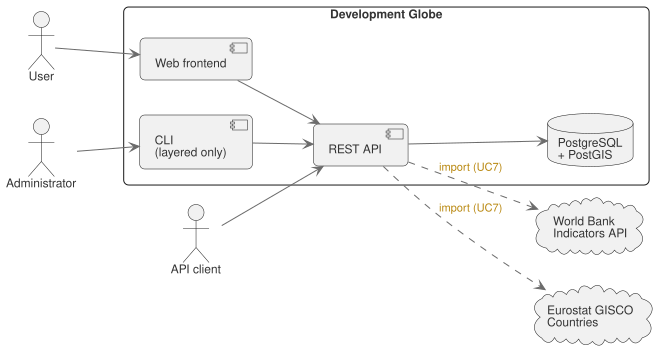
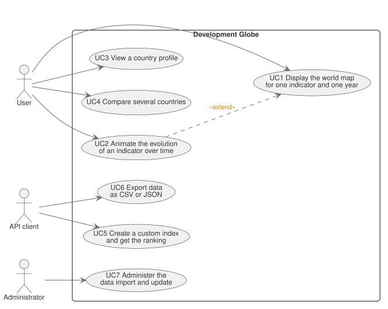
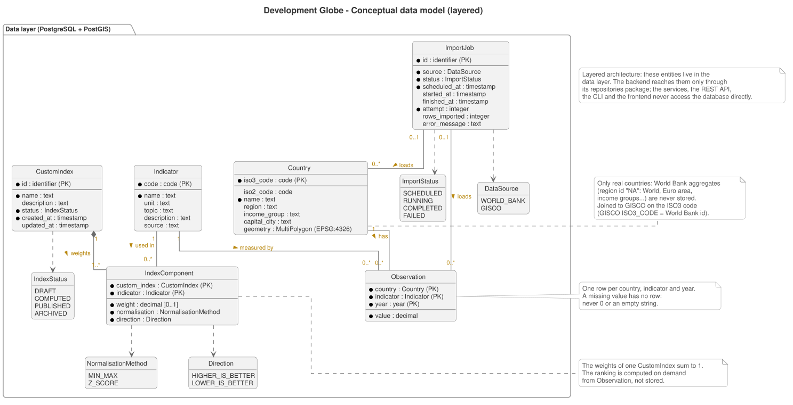

# Software Requirements Specification — Development Globe

*Software Engineering 2026-2027, NTUA — Team softeng26-02*

| Version | Date | Description |
|---|---|---|
| 0.1 | 26/11/2026 | General sections (introduction, overall description, non-functional requirements, glossary) |

---

## 1. Introduction

### 1.1 Purpose

This document specifies the requirements of **Development Globe**, a web application that shows on an interactive world map how countries have evolved over the last 50 years, using open data from the World Bank and Eurostat.

It is written for the development team, the course instructors who assess it, and anyone who will use the application's REST API. It is the reference for the design, implementation and testing of the application in both required architectures (layered and MVC).

### 1.2 Scope

Development Globe lets a user:

- display a world map coloured by one development indicator (life expectancy, GDP per capita, access to electricity, CO₂ emissions...) for one year;
- animate the map over a period of years to watch the world change;
- open the profile of a country with the time series of its indicators;
- compare several countries on one or more indicators;
- build a custom index by weighting several indicators, and get the resulting country ranking;
- export data as CSV or JSON through a public REST API, also used by a command line interface;
- (administrator) import and update the data from the World Bank and Eurostat GISCO.

The application covers the **sovereign countries and territories** present in both data sources, with **yearly** values from **1975** to the **latest year available** in the World Bank data. It works on a **curated set of indicators** chosen by the administrator, not on the 16,000 series offered by the World Bank.

Out of scope: real-time or sub-yearly data, regional or city-level data, forecasts, user accounts and authentication for regular users, native mobile applications.

The same application is built twice, with two architectures required by the course:

- **Layered:** backend, REST API, command line interface (CLI) calling the API, one responsive web frontend for desktop and smartphone.
- **MVC:** backend (Model and Controller), REST API, two separate web Views, one for desktop and one for smartphone.

### 1.3 Definitions, acronyms and abbreviations

See the [Glossary](#6-glossary) in section 6.

### 1.4 References

| Ref. | Document |
|---|---|
| [1] | Semester Project for the Course "Software Engineering", NTUA, Fall 2026-2027 (`documentation/project_softeng2026_v01_en.pdf`) |
| [2] | Development Globe — Project overview and work plan (`documentation/Development_Globe_Project_Plan.md`) |
| [3] | World Bank Indicators API documentation — https://datahelpdesk.worldbank.org/knowledgebase/articles/889392 |
| [4] | GISCO Countries dataset, Eurostat — https://gisco-services.ec.europa.eu/distribution/v2/countries/ |
| [5] | IEEE Std 830-1998, Recommended Practice for Software Requirements Specifications |

### 1.5 Overview

Section 2 describes the product as a whole: its context, users, environment and constraints. Section 3 specifies the functional requirements as seven use cases. Section 4 describes the data. Section 5 lists the non-functional requirements. Section 6 is the glossary.

---

## 2. Overall description

### 2.1 Product perspective

Development Globe is a new, self-contained application. It depends on two external open data sources, which are imported into its own database by the administrator; the application never queries them while a user is browsing.



<details>
<summary>PlantUML source</summary>

```plantuml
@startuml softeng26-02-srs-context
!include ../diagram-as-code/style.puml
left to right direction

actor "User" as user
actor "API client" as client
actor "Administrator" as admin

rectangle "Development Globe" {
  component "Web frontend" as front
  component "CLI\n(layered only)" as cli
  component "REST API" as api
  database "PostgreSQL\n+ PostGIS" as db
}

cloud "World Bank\nIndicators API" as wb
cloud "Eurostat GISCO\nCountries" as gisco

user --> front
client --> api
admin --> cli
front --> api
cli --> api
api --> db
api ..> wb : import (UC7)
api ..> gisco : import (UC7)
@enduml
```

</details>

### 2.2 Product functions



<details>
<summary>PlantUML source</summary>

```plantuml
@startuml softeng26-02-srs-use-cases
!include ../diagram-as-code/style.puml
left to right direction

actor "User" as user
actor "API client" as client
actor "Administrator" as admin

rectangle "Development Globe" {
  usecase "UC1 Display the world map\nfor one indicator and one year" as UC1
  usecase "UC2 Animate the evolution\nof an indicator over time" as UC2
  usecase "UC3 View a country profile" as UC3
  usecase "UC4 Compare several countries" as UC4
  usecase "UC5 Create a custom index\nand get the ranking" as UC5
  usecase "UC6 Export data\nas CSV or JSON" as UC6
  usecase "UC7 Administer the\ndata import and update" as UC7
}

user --> UC1
user --> UC2
user --> UC3
user --> UC4
client --> UC5
client --> UC6
admin --> UC7

UC2 ..> UC1 : <<extend>>
@enduml
```

</details>

| # | Use case | Main actor | In the frontend |
|---|---|---|---|
| UC1 | Display the world map for one indicator and one year | User | Yes |
| UC2 | Animate the evolution of an indicator over a period of years | User | Yes |
| UC3 | View a country profile with the time series of its indicators | User | Yes |
| UC4 | Compare several countries on one or more indicators | User | Yes |
| UC5 | Create a custom index (weighted indicators) and get the country ranking | API client | No (API) |
| UC6 | Export data as CSV or JSON | API client | No (API and CLI) |
| UC7 | Administer the import and update of World Bank and GISCO data | Administrator | No (API, and CLI in layered) |

### 2.3 User classes and characteristics

| Actor | Description |
|---|---|
| **User** | Anyone opening the web application: students, journalists, teachers, curious citizens. No account, no technical knowledge expected. Uses a desktop browser or a smartphone. |
| **API client** | A developer or a script calling the public REST API, including the project's own CLI. Knows HTTP and JSON or CSV. |
| **Administrator** | A member of the team who runs the data import and update. Uses the CLI (layered) or calls the API directly (MVC), and is identified by an administrator key. |

### 2.4 Operating environment

- **Server side:** Python 3.12 backend (FastAPI), PostgreSQL 16 with PostGIS 3.4, run locally with Docker Compose.
- **Client side:** the latest two versions of Chrome, Firefox, Safari and Edge, on desktop (from 1280 px wide) and smartphone (from 360 px wide).
- **CLI:** any terminal with Python 3.12, on macOS, Linux or Windows.

### 2.5 Design and implementation constraints

- Two architectures (layered and MVC) must be built and documented; the CLI exists only in the layered architecture.
- Backend in Python; database PostgreSQL; documents in Markdown and diagrams in PlantUML; full UML model in Visual Paradigm; code and project management on GitHub [1].
- The REST API is the only access to the data for the frontend and the CLI.
- External data may only be used under its licence: World Bank data under CC BY 4.0, GISCO boundaries with the attribution "© EuroGeographics for the administrative boundaries".

### 2.6 Assumptions and dependencies

- The World Bank Indicators API and the GISCO download service stay available and keep their current formats; they are only needed during an import (UC7).
- Both sources identify countries with the ISO 3166-1 alpha-3 (ISO3) code, which is used to join them.
- World Bank values are published with a delay of one to two years, and many are missing for small countries and early years.

---

## 3. Functional requirements

Each use case is described with the template below, and has an activity diagram in both architectures (`documentation/diagram-as-code/layered/` and `.../mvc/`).

| Field | Content |
|---|---|
| **ID and name** | UCx — name |
| **Actor** | Main actor |
| **Preconditions** | What must be true before the use case starts |
| **Main flow** | Numbered steps of the normal scenario |
| **Alternative flows** | Errors and variants, numbered after the step where they start |
| **Postconditions** | What is true at the end |
| **Diagrams** | Links to the activity (and state) diagrams |

### 3.1 UC1 — Display the world map for one indicator and one year

*To be written by Anthony.*

### 3.2 UC2 — Animate the evolution of an indicator over time

*To be written by Anthony.*

### 3.3 UC3 — View a country profile

**ID and name:** UC3 — View a country profile with the time series of its indicators

**Actor:** User

**Preconditions**

- The web application is open (layered: the responsive frontend; MVC: the desktop view `desktop.html` or the smartphone view `mobile.html`).
- The country list (ISO3 code, name) and the indicator list are loaded.
- Data is available from 1975 to the latest available year.

**Main flow**

1. The user selects a country, by clicking it on the map (UC1) or by searching it by name.
2. The frontend requests the country profile from the REST API: `GET /api/countries/{iso3}`.
3. The API checks that the ISO3 code has a valid format (three letters, for example `GRC`).
4. The API reads the country (name, region, income group) and its observations for every indicator, from 1975 to the latest available year.
5. The API checks that the country exists and returns the country data and one time series per indicator (year, value, unit).
6. The frontend shows the profile header (name, region, income group) and one line chart per indicator. Missing years are shown as gaps, never as 0.
7. The user hovers (desktop) or taps (smartphone) a point of a chart; the frontend shows a tooltip with the indicator, year, value and unit.
8. Optionally, the user adds the country to a comparison: the comparison view opens with this country preselected (UC4).

**Alternative flows**

- **3a. Invalid code:** the ISO3 code does not have a valid format. The API returns HTTP 400 and the frontend shows "Invalid country code". The use case ends.
- **4a. Database unavailable:** the API returns HTTP 503 and the frontend shows an error message with a retry button (NFR-REL-04, NFR-USE-05). Retrying restarts at step 2.
- **5a. Unknown country:** no country has this ISO3 code. This includes World Bank aggregates such as `WLD`, which are never stored as countries (NFR-REL-01). The API returns HTTP 404 and the frontend shows "Country not found". The use case ends.
- **6a. Indicator without data:** an indicator has no value at all for this country. Its chart is replaced by the label "No data" (NFR-USE-02).
- **6b. Smartphone:** the charts are shown one at a time and the user swipes between indicators; on a desktop all charts are shown side by side. In the MVC architecture, this is the difference between the smartphone view and the desktop view.

**Postconditions**

- The profile of the selected country is displayed.
- No data has been changed (read-only use case, NFR-SEC-01).

**Diagrams**

- Activity diagram, layered: [softeng26-02-uc03-activity.puml](../diagram-as-code/layered/softeng26-02-uc03-activity.puml) ([SVG](../diagram-as-code/layered/softeng26-02-uc03-activity.svg))
- Activity diagram, MVC: [softeng26-02-uc03-activity.puml](../diagram-as-code/mvc/softeng26-02-uc03-activity.puml) ([SVG](../diagram-as-code/mvc/softeng26-02-uc03-activity.svg))

### 3.4 UC4 — Compare several countries

**ID and name:** UC4 — Compare several countries on one or more indicators

**Actor:** User

**Preconditions**

- The web application is open (layered: the responsive frontend; MVC: the desktop view `desktop.html` or the smartphone view `mobile.html`).
- The country list (ISO3 code, name) and the indicator list are loaded.
- Data is available from 1975 to the latest available year.
- Optionally, one country is already preselected from its profile (UC3, step 8).

**Main flow**

1. The user selects 2 to 5 countries, one or more indicators and a period (by default from 1975 to the latest available year).
2. The frontend checks the selection: 2 to 5 different countries and at least one indicator.
3. The frontend requests the observations from the REST API: `GET /api/observations?countries={iso3,...}&indicators={code,...}&from={y1}&to={y2}`.
4. The API validates the parameters: ISO3 format of the country codes, `from` not after `to`, period within 1975 to the latest available year.
5. The API reads the observations of the selected countries and indicators for the period.
6. The API checks that all countries and indicators exist and returns one time series per country and indicator (year, value, unit).
7. The frontend draws one line chart per indicator, with its own axis and unit, and one line per country. Missing years are shown as gaps, never as 0. Indicators are never drawn on a shared axis because their units differ; combining them is the purpose of the custom index (UC5).
8. The user hovers (desktop) or taps (smartphone) a point of a chart; the frontend shows a tooltip with the country, indicator, year, value and unit.

**Alternative flows**

- **2a. Incomplete selection:** fewer than 2 or more than 5 different countries, or no indicator. The frontend shows the hint "Select 2 to 5 different countries and at least one indicator", sends no request, and the flow returns to step 1.
- **4a. Invalid input:** the API returns HTTP 400 with an explanation (NFR-SEC-03) and the frontend shows the error message. The use case ends.
- **5a. Database unavailable:** the API returns HTTP 503 and the frontend shows an error message with a retry button (NFR-REL-04, NFR-USE-05). Retrying restarts at step 3.
- **6a. Unknown country or indicator:** at least one code does not exist, including World Bank aggregates such as `WLD` (NFR-REL-01). The API returns HTTP 404 and the frontend shows "Unknown country or indicator". The use case ends.
- **7a. Country without data:** a country has no value for an indicator over the period. It is marked "No data" in the legend of that chart (NFR-USE-02).
- **7b. Smartphone:** the charts are shown one at a time and the user swipes between indicators; on a desktop all charts are shown side by side. In the MVC architecture, this is the difference between the smartphone view and the desktop view.

**Postconditions**

- The comparison of the selected countries is displayed.
- No data has been changed (read-only use case, NFR-SEC-01).

**Diagrams**

- Activity diagram, layered: [softeng26-02-uc04-activity.puml](../diagram-as-code/layered/softeng26-02-uc04-activity.puml) ([SVG](../diagram-as-code/layered/softeng26-02-uc04-activity.svg))
- Activity diagram, MVC: [softeng26-02-uc04-activity.puml](../diagram-as-code/mvc/softeng26-02-uc04-activity.puml) ([SVG](../diagram-as-code/mvc/softeng26-02-uc04-activity.svg))

### 3.5 UC5 — Create a custom index and get the country ranking

*To be written by Jules.*

### 3.6 UC6 — Export data as CSV or JSON

*To be written by Edrik.*

### 3.7 UC7 — Administer the data import and update

*To be written by Edrik.*

---

## 4. Data requirements

### 4.1 Data sources

| Source | Content used | Access | Format | Licence |
|---|---|---|---|---|
| World Bank Indicators API v2 [3] | Country list (ISO3 code, name, region, income group, capital) and yearly indicator time series | `https://api.worldbank.org/v2/`, `format=json`, paginated, no key | JSON | CC BY 4.0 |
| GISCO Countries, Eurostat [4] | Country boundaries, release 2024, scale 1:20M, EPSG:4326 (`CNTR_RG_20M_2024_4326.geojson`) | Bulk HTTP download, no key | GeoJSON (MultiPolygon) | © EuroGeographics for the administrative boundaries |

The two sources are joined on the **ISO3 country code**: `id` in the World Bank country list, `ISO3_CODE` in GISCO. The 2-letter codes are never used for the join, because they differ between the sources (Greece is `GR` at the World Bank and `EL` in GISCO).

Observations from an exploration of both sources (November 2026):

- The World Bank country list returns **296 entries**: **217 economies** and **79 aggregates** (World, regions, income groups...).
- GISCO 2024 (1:20M) contains **263 features**, all of type MultiPolygon, each with an ISO3 code.
- **214** of the 217 economies have a geometry. The 3 without one are Channel Islands (`CHI`, split in GISCO into Jersey `JEY` and Guernsey `GGY`), Kosovo (`XKX`) and Saint Martin (`MAF`, too small for the 1:20M scale).
- **49** GISCO features have no World Bank economy: small territories (e.g. Antarctica `ATA`, Falkland Islands `FLK`, Vatican `VAT`) and disputed areas with codes starting with `X` (e.g. Aksai Chin `XC`, Abyei `XU`).

### 4.2 Conceptual data model

The conceptual data model is the same in both architectures. Only its place in the architecture differs: in the layered architecture the entities live in the data layer and are reached only through the backend repositories; in the MVC architecture they form the Model, used by the Controllers.



*Sources: [layered](../diagram-as-code/layered/softeng26-02-data-conceptual.puml), [MVC](../diagram-as-code/mvc/softeng26-02-data-conceptual.puml).*

| Entity | Description | Identifier |
|---|---|---|
| **Country** | A World Bank economy with its boundary: name, region, income group, capital city, geometry (MultiPolygon, EPSG:4326). | ISO3 code |
| **Indicator** | A World Bank indicator: name, unit, topic, description, source. | World Bank code (e.g. `SP.DYN.LE00.IN`) |
| **Observation** | The value of one indicator for one country and one year. | Country + Indicator + year |
| **CustomIndex** | An index built by a user from several weighted indicators (UC5), with a status: Draft, Computed, Published, Archived. | Generated identifier |
| **IndexComponent** | One indicator of a custom index, with its weight, its normalisation method (min-max or z-score) and its direction (higher or lower is better). | CustomIndex + Indicator |
| **ImportJob** | One import of World Bank or GISCO data (UC7), with its status (Scheduled, Running, Completed, Failed), dates, attempt number, number of rows imported and error message. | Generated identifier |

Relationships:

- A Country has 0..* Observations; an Indicator is measured by 0..* Observations; each Observation belongs to exactly one Country and one Indicator.
- A CustomIndex is composed of 1..* IndexComponents (deleting the index deletes its components); each IndexComponent refers to exactly one Indicator.
- An ImportJob loads 0..* Countries and Observations; each of them records the job that last loaded it.

### 4.3 Data requirements

| ID | Requirement |
|---|---|
| DR-01 | Only World Bank economies are stored as Country. Aggregates, identified by `region.id == "NA"`, are never stored as countries (see NFR-REL-01). |
| DR-02 | Country and geometry are joined on the ISO3 code only. A Country without a GISCO geometry (Channel Islands, Kosovo, Saint Martin) is stored without geometry: its data stays available in the API, country profiles, comparisons and exports, but it is not drawn on the map. |
| DR-03 | GISCO features without a matching World Bank economy (small territories, disputed areas) are not stored as Country. |
| DR-04 | A missing value (`"value": null` in the World Bank response) creates no Observation. A value is never replaced by 0 or an empty string (see NFR-USE-02). |
| DR-05 | There is at most one Observation per country, indicator and year. Re-importing an indicator replaces the existing values instead of duplicating them. |
| DR-06 | The application stores the period **1975 to the latest available year** (about 50 years). Data is yearly: there is no real-time data, and the latest year is often incomplete (most countries have no value yet). |
| DR-07 | The application uses a curated list of indicators chosen by the team (life expectancy, GDP per capita, CO₂ emissions, access to electricity...), not all of the ~16,000 World Bank indicators. |
| DR-08 | The weights of the IndexComponents of one CustomIndex are greater than 0 and sum to 1. The ranking of a custom index is computed on demand from the Observations, not stored. |
| DR-09 | Each import is recorded as an ImportJob before it starts, and its status is updated when it ends (see NFR-REL-03). A failed import leaves the previous data unchanged (see NFR-REL-02). |
| DR-10 | The full database (countries, geometries, indicators, observations) is delivered as a plain SQL dump, `softeng26-02-dump.sql`, in `layered/data` and `mvc/data` (see NFR-MAIN-04). |

### 4.4 Known data pitfalls

| Pitfall | Example | Handling |
|---|---|---|
| Aggregates mixed with countries | `WLD` (World), `EUU` (European Union), `HIC` (High income) appear in the country list and in indicator responses. | Filtered out on import (DR-01). |
| Different 2-letter codes | Greece is `GR` at the World Bank, `EL` in GISCO. | Join on ISO3 only (DR-02). |
| Missing values | Small countries and old years often have no value; the latest year is mostly empty (e.g. life expectancy for Greece: `null` in 2025, 81.8 in 2024). | No Observation row; shown as "No data" in grey (DR-04, NFR-USE-02). |
| Countries without geometry | `CHI`, `XKX`, `MAF` have no GISCO feature at 1:20M. | Stored without geometry, not drawn on the map (DR-02). |
| Territories without data | Antarctica, Falkland Islands, disputed areas. | Not stored as countries; may be drawn in grey as background if needed (DR-03). |
| Yearly data, irregular updates | The World Bank updates indicators a few times a year. | Imports are run by the administrator (UC7), not continuously (DR-06). |
| Units differ between indicators | Years, current US$, % of population, metric tons per capita. | The unit is stored in Indicator and shown in every legend (NFR-USE-01). |

---

## 5. Non-functional requirements

### 5.1 Performance

| ID | Requirement |
|---|---|
| NFR-PERF-01 | The values of one indicator for one year (UC1) are returned by the API in less than **500 ms** for 95% of requests, with 50 concurrent users. |
| NFR-PERF-02 | All years of one indicator for an animation (UC2) are returned in a single API call in less than **2 s** for 95% of requests. |
| NFR-PERF-03 | Changing the year during an animation recolours the map in less than **200 ms**, without reloading the country geometries. |
| NFR-PERF-04 | The web application displays the first map in less than **3 s** on a desktop broadband connection. |
| NFR-PERF-05 | Performance requirements are checked with load tests (Locust) for both architectures. |

### 5.2 Usability and accessibility

| ID | Requirement |
|---|---|
| NFR-USE-01 | Every map has a legend with the indicator name, its unit and the year. |
| NFR-USE-02 | Countries without a value are shown in grey and labelled "No data", never as zero. |
| NFR-USE-03 | Colour scales are readable by colour-blind users (sequential, colour-blind-safe palettes). |
| NFR-USE-04 | All functions of UC1–UC4 work with a mouse (hover) on desktop and with touch (tap) on smartphone. |
| NFR-USE-05 | Error messages say what went wrong and what the user can do (for example a retry button when the server is unavailable). |
| NFR-USE-06 | The interface is in English. |

### 5.3 Compatibility and portability

| ID | Requirement |
|---|---|
| NFR-COMP-01 | The frontend works on the browsers listed in section 2.4, on screens from 360 px to 1920 px wide, without horizontal scrolling. |
| NFR-COMP-02 | The layered frontend is a single responsive application; the MVC frontend provides two separate Views (desktop and smartphone). |
| NFR-COMP-03 | The whole application starts on a new machine with Docker Compose and the documented commands, without manual database setup. |

### 5.4 Security

| ID | Requirement |
|---|---|
| NFR-SEC-01 | Public API endpoints are read-only, except the creation of custom indices (UC5). |
| NFR-SEC-02 | Import and update operations (UC7) require an administrator key sent in an HTTP header. |
| NFR-SEC-03 | Every API input (indicator code, country code, year, weights) is validated; invalid input returns HTTP 400 with an explanation. |
| NFR-SEC-04 | Database access uses parameterised queries only. |
| NFR-SEC-05 | No secret (password, key) is stored in the repository; configuration comes from environment variables. |

### 5.5 Reliability and data quality

| ID | Requirement |
|---|---|
| NFR-REL-01 | World Bank aggregates (World, income groups, regions...) are never stored or shown as countries. |
| NFR-REL-02 | A failed import leaves the previously imported data unchanged and usable. |
| NFR-REL-03 | Each import is recorded with its source, status, dates and errors. |
| NFR-REL-04 | When the database is unavailable, the API returns HTTP 503 and the frontend shows an error instead of an empty map. |

### 5.6 Maintainability and testability

| ID | Requirement |
|---|---|
| NFR-MAIN-01 | Every API endpoint is documented in an OpenAPI specification, delivered in `documentation/apis/`. |
| NFR-MAIN-02 | Every API endpoint and every CLI command has automated functional tests (pytest). |
| NFR-MAIN-03 | Code follows the team's lint and format rules (Ruff for Python, ESLint and Prettier for JavaScript). |
| NFR-MAIN-04 | A data dump allows the database to be restored without calling the external sources. |

### 5.7 Legal

| ID | Requirement |
|---|---|
| NFR-LEG-01 | The application displays the data sources and their attribution: "Source: World Bank, CC BY 4.0" and "© EuroGeographics for the administrative boundaries". |

---

## 6. Glossary

| Term | Definition |
|---|---|
| **Administrator** | Team member allowed to import and update the data (UC7). |
| **Aggregate** | A World Bank entry that groups several countries (World, Euro area, income groups, regions). Not a country. |
| **API** | Application Programming Interface. Here, the REST API of Development Globe. |
| **API client** | Any program calling the REST API, including the CLI. |
| **Choropleth map** | A map where each country is filled with a colour that depends on its value for an indicator. |
| **CLI** | Command Line Interface: the `globe` command, which calls the REST API (layered architecture only). |
| **Colour scale** | The rule that turns a value into a colour on the map, shown in the legend. |
| **Country profile** | The page showing the time series of the indicators of one country (UC3). |
| **CSV** | Comma-Separated Values, a text format for tables. |
| **Custom index** | An index built by a user by weighting several indicators, used to rank countries (UC5). |
| **GeoJSON** | A JSON format for geographic shapes, used by GISCO for country boundaries. |
| **GISCO** | Geographic Information System of the Commission (Eurostat), source of the country boundaries. |
| **Import job** | One run of the import of data from an external source, with its status (UC7). |
| **Index component** | One indicator inside a custom index, with its weight and normalisation method. |
| **Indicator** | A World Bank time series measuring one aspect of development, identified by a code (for example `SP.DYN.LE00.IN` for life expectancy). |
| **ISO3 code** | The ISO 3166-1 alpha-3 country code (for example `GRC` for Greece), used to join World Bank and GISCO data. |
| **JSON** | JavaScript Object Notation, a text format for structured data. |
| **Layered architecture** | Architecture where the application is split into layers (presentation, API, business logic, data access), each using only the layer below it. |
| **Missing value** | A year for which the World Bank has no value for a country and an indicator. |
| **MVC** | Model-View-Controller: architecture separating the data and logic (Model), the request handling (Controller) and the display (View). |
| **Normalisation** | Rescaling indicators with different units to a common range before combining them in a custom index. |
| **Observation** | The value of one indicator for one country and one year. |
| **OpenAPI** | A standard format for describing a REST API. |
| **PostGIS** | The PostgreSQL extension for storing and querying geographic shapes. |
| **REST** | Representational State Transfer: a style of web API based on HTTP resources and methods. |
| **SRS** | Software Requirements Specification: this document. |
| **Time series** | The values of one indicator for one country over several years. |
| **World Bank Indicators API** | The public World Bank web service providing development indicators per country and year. |
