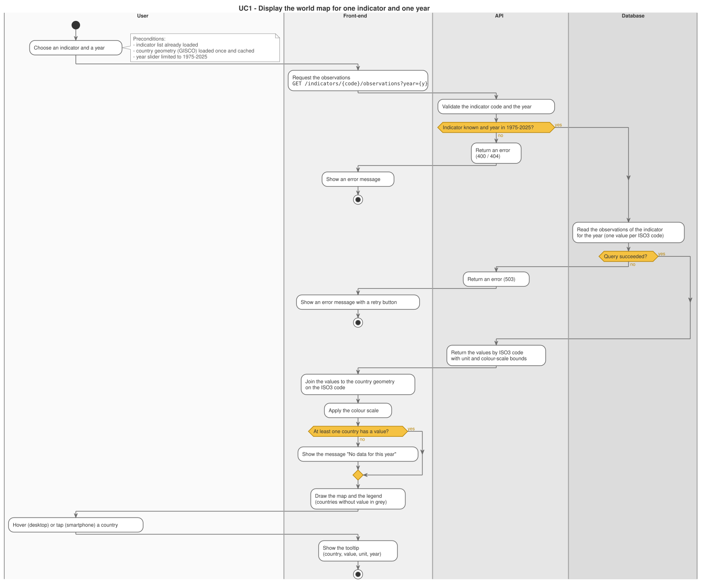
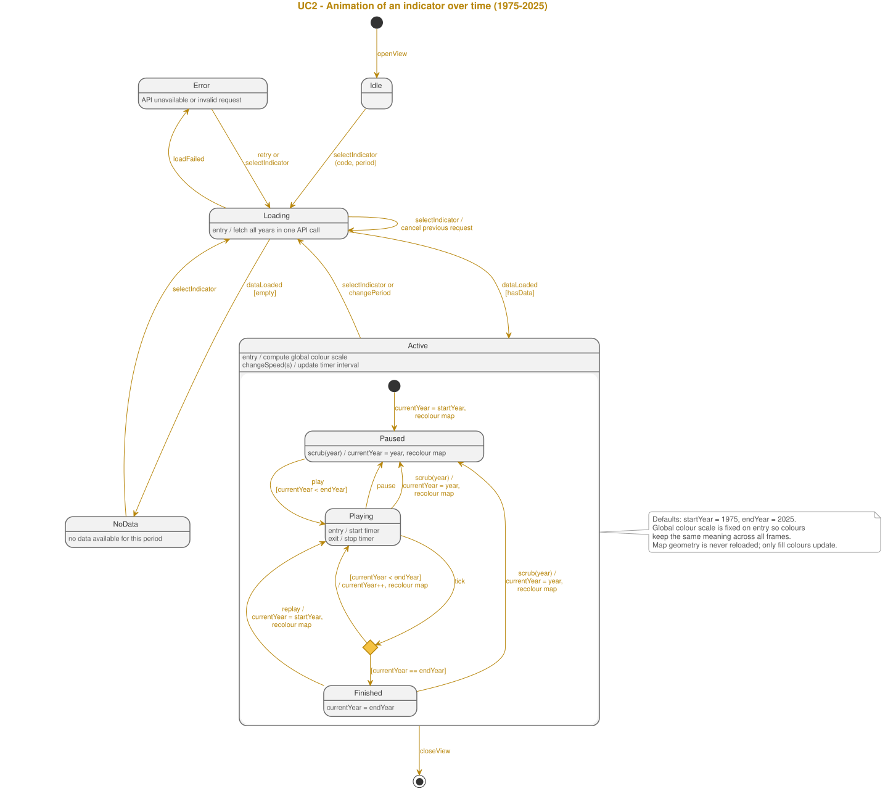

#### UC1 – Activity diagram

*Figure X – UC1 activity diagram. Source: [uc1_activity.puml](diagrams/uc1_activity.puml)*

#### UC2 – State diagram

*Figure Y – UC2 state diagram. Source: [uc2_state.puml](diagrams/uc2_state.puml)*